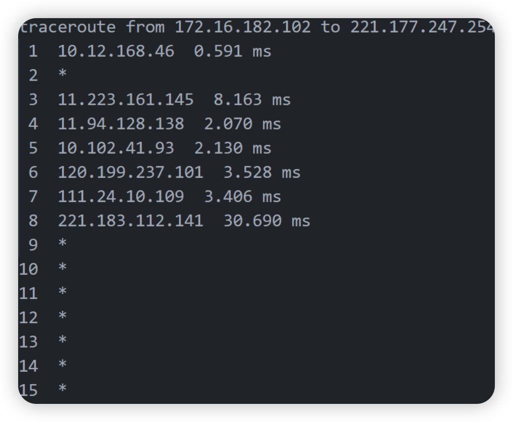
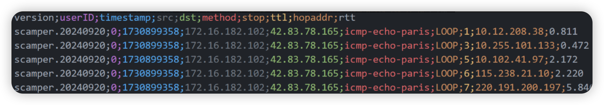

# **scamper概述**

Scamper工具能够以每秒数据包速率（packets-per-second）执行对IPv4和IPv6地址的网络测量技术，并支持并行操作。目前，Scamper支持的功能包括常用的traceroute和ping技术、DNS、多路径侦测（MDA traceroute）、六种不同的别名解析技术、大部分tbit方法、sting、邻居发现、HTTP(S)以及UDP探测。scamper 旨在以并行方式（以指定的每秒数据包速率）主动探测互联网中的目的地，以便及时收集批量数据。

## **scamper使用**

Scamper有以下五种运行模式：

- **-i**选项在命令行中提供一个或多个地址，Scamper会并行执行对每个地址的测量命令，并在每个任务完成后输出结果
- **-f**选项从一个地址列表文件中读取地址，每行一个地址
- **-I**选项在命令行中提供一组完整的命令
- -P选项指定一个IP地址和端口，或通过**-U**选项指定一个Unix域套接字，使Scamper在该地址上动态接受命令
- **-R**选项连接到指定的远程主机和端口，从远程动态接收命令

````
```
scamper [ −?] [ −c command] [ −p pps] [ −w window] [ −M monitorname][ −l listname] [ −L listid] [ −C cycleid] [ −o outfile] [ −F firewall][ −n nameserver] [ −d debugfile] [ −e pidfile] [ −O options][ −i IPs | −I cmds | −f file | −P [ip:]port | −R name:port | −U unix-dom]
```
常用参数解析
-c command 后面跟trace、ping等
-p pps 发送包的速度
-f listfile 指定探测地址list在的文件路径
-o outfile 结果输出到指定文件
-P [ip:]port 监听的主机 ip和端口
-R name:port 指定scamper连接到指定的主机和端口以接收命令
````

在scamper参数中，-c用来指定scamper默认命令，当前的选项包括：

- dealias：使用Ally、Mercator、MIDAR或Radargun样式的探测，推断属于同一系统的IP地址。

- http：执行HTTP请求。

- host：向域名服务器发送简单的DNS查询。

- neighbourdisc：发送IPv4 ARP或IPv6邻居发现查询，以确定同一网络中IP地址的第2层地址。

- ping：使用各种探测类型进行简单的延迟测量。

- trace：进行经典或Paris-style的traceroute探测，推断到目标的单一路径。

- tracelb：使用多路径发现算法（MDA），推断到目标的负载均衡路径。

- sniff：使用tcpdump样式的过滤表达式捕获到主机的部分数据包。

- sting：使用sting方法推断TCP接收端的单向数据包丢失情况。

- tbit：使用TCP行为推断工具（TBIT）的方法，推断TCP接收端的特性。

- udpprobe：发送UDP探测包并等待响应


下面是其中的trace命令（traceroute）：


````
```
trace [ −MQT] [ −c confidence] [ −d dport] [ −f firsthop] [ −g gaplimit][ −G gapaction] [ −l loops] [ −m maxttl] [ −o offset] [ −O option] [ −p payload][ −P method] [ −q attempts] [ −r rtr-addr] [ −s sport] [ −S srcaddr] [ −t tos][ −U userid] [ −w wait] [ −W wait-probe] [ −z gss-entry] [ −Z lss-name]
```
常用参数
-g gaplimit 设定跳跃点无反应的数，默认为5跳无反应就结束
-m maxttl 指定探测TTL或HLIM的最大值，默认无限制
-P method 指定要使用的traceroute方法
````

**示例：**

对inputfile中ip以发报速率为10进行traceroute探测输出到outputfile中,最大ttl是30，连续30次探测无反应则进行返回（确保每次探测都是30跳），icmp-paris 调整了 ICMP 请求的 ID 和序列号，以使负载均衡路由器始终选择相同的路径，从而获得一致的路径信息，在多路径网络中保持探测一致性

```
scamper -c 'trace -P icmp-paris -m 30 -g 30' -p 10 -f $inputfile -o $outputfile
```


## 结果文件

1. scamper有标准输出。



2. warts格式，二进制文件。

**sc_warts2csv** —— 将scamper收集的traceroute数据以csv格式导出，并不支持traceroute中以外的warts记录



timestamp: 开始执行的时间

src : 源ip

dst: 目的ip

method：icmp-echo-paris方法保持在路径探测中选择的都是相同的路径。

stop:停止原因

- LOOP：表示探测任务在网络路径中检测到了循环，既存在路由环路。
- COMPLETED： 表示探测任务已经完成，即达到了目标ip地址，并收到了目标的响应。
- HOPLIMIT：表示探测任务已达到预设的跳数限制，而在限制范围内扔未到达目标地址。
- UNREACH：路径上某一跳出现了“不可达”情况

ttl: 跳数

hopaddr: 中间路由ip

rtt：时延

**sc_warts2json** ——— 以warts输出结果，使用sc_warts2json将warts转换为json

结果字段如下：

```
{
  "type": "trace",
  "version": "0.1",
  "userid": integer, 
  "method": string, // 使用-P参数传递的方法
  "src": string, // 源地址
  "dst": string, // 目标地址
  "rtr": string, // 使用-r参数传递的第一跳路由器
  "sport": integer, // TCP/UDP 跟踪的源端口
  "dport": integer, // TCP/UDP 跟踪的目标端口
  "icmp_sum": integer, // ICMP 跟踪的校验和
  "stop_reason": string, // 跟踪终止的原因
  "stop_data": integer, // 跟踪终止的附加上下文
  "start": timestamp结构, // 报告跟踪开始时间的时间戳结构
  {
    "sec": integer, // 自1970年以来的秒数
    "usec": integer, // 当前秒内经过的微秒数
    "ftime": string // 格式化时间，格式为YYYY-MM-DD HH:MM:SS
  },
  "hop_count": integer, // 此次跟踪中探测的最后一个TTL
  "attempts": integer, // 每跳的尝试次数
  "hoplimit": integer, // 跟踪将探测的最大TTL
  "firsthop": integer, // 跟踪探测的第一个TTL
  "wait": integer, // 在重试探测前等待的秒数
  "wait_probe": integer, // 探测之间等待的额外毫秒数（以10毫秒为单位）
  "tos": integer, // 在ToS/DSCP字段中使用的值
  "probe_size": integer, // 发送的探测包大小
  "probe_count": integer, // 此次跟踪总共发送的探测包数量
  "hops": { // 跳点结构的数组
    {
      "addr": string, // 在响应中接收到的地址
      "name": string, // 与地址关联的 PTR 记录
      "probe_ttl": integer, // 此探测使用的 TTL
      "probe_id": integer, // 从0开始计数的此跳的尝试编号
      "probe_size": integer, // 发送的探测包大小
      "tx": timestamp结构, // 报告探测包发送时间的时间戳结构
      {
        "sec": integer, // 自1970年以来的秒数
        "usec": integer // 当前秒内经过的微秒数
      },
      "rtt": integer.integer,
      "reply_ttl": integer, // 在响应包中接收到的IP TTL值
      "reply_tos": integer, // 在响应包中接收到的IP TOS值
      "reply_ipid": integer, // 在响应包中接收到的IP ID值
      "reply_size": integer, // 响应包的大小
      "icmp_type": integer, // ICMP响应的类型
      "icmp_code": integer, // ICMP响应的代码
      "icmp_q_ttl": integer, // 引用的IP包中的TTL值
      "icmp_q_ipl": integer, // 引用的IP包中的IP长度值
      "icmp_q_tos": integer, // 引用的IP包中的TOS值
      "icmp_nhmtu": integer, // 如果响应是“包过大”，则为 MTU 值
      "tcp_flags": integer, // 如果响应是TCP，则为TCP标志
      "icmpext": { // ICMP 扩展结构的数组
        {
          "ie_cn": integer, // ICMP 扩展的类号
          "ie_ct": integer, // ICMP 扩展的类类型
          "ie_dl": integer, // ICMP 扩展的数据长度
          "mpls_labels": { // 包含 MPLS 标签栈条目的数组
            {
              "mpls_ttl": integer, // MPLS ICMP 扩展中的 TTL
              "mpls_s": integer, // 栈底标志位
              "mpls_exp": integer, // 实验使用字段中的值
              "mpls_label": integer // 20 位的 MPLS 标签
            }
          }
        }
      }
    }
  }
}
```
