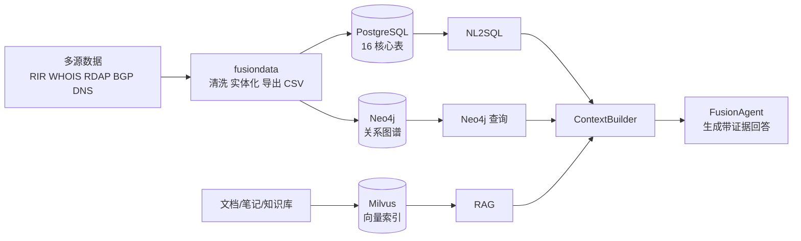

# 当前架构

## 总体结构

系统分为离线数据处理与在线问答两条链路：

1. `fusiondata/` 将 RIR/WHOIS/RDAP、BGP、DNS/网站等数据清洗为标准化 CSV。
2. `agent/scripts/load_all_csv.py` 将 CSV 导入 PostgreSQL 16 张核心表，并按需写入 Neo4j。
3. `agent/knowledge_ingest.py` 与 `agent/tools/rag_ingest_pipeline.py` 将文档写入 Milvus。
4. `FusionAgent` 基于 LangGraph 编排 NL2SQL、RAG、Neo4j 查询，组织证据后生成回答。

## 在线主链路

当前主干实现采用 **LangGraph + FastMCP**：
- `agent/runtime/fusion_agent.py`：对外暴露统一问答入口。
- `agent/runtime/langgraph_orchestrator.py`：计划、调度、执行、重规划、回答生成。
- `agent/runtime/context_builder.py`：汇总结构化结果、文档证据和上下文。
- `agent/services/mcp/client.py`：统一调用 FastMCP 工具。
- `agent/services/mcp/server.py`：暴露 `nl2sql_query`、`rag_search`、`neo4j_llamaindex_query`、`note_search`、`todo_*` 等工具。
- `agent/services/http/server.py`：提供 API 与流式响应接口。

## 当前目录职责
- `agent/core/`：配置、提示词、模型、追踪、Schema。
- `agent/runtime/`：主编排、状态模型、上下文构建。
- `agent/services/http/`：FastAPI HTTP 服务。
- `agent/services/mcp/`：FastMCP 服务端与客户端。
- `agent/tools/`：底层工具实现。
- `agent/scripts/`：导入、建索引、评测、排障脚本。
- `fusiondata/src/`：离线融合处理逻辑。

## 关键设计决策
- PostgreSQL 是事实源，保证可审计与结构化查询稳定性。
- Milvus 和 Neo4j 是派生索引，分别承担文档语义检索和关系推理。
- 在线编排统一走 LangGraph，不再维护历史 A2A/子代理链路。
- 工具层统一走 FastMCP，避免把工具直接耦合进主代理。
- 回答阶段优先消费当前轮结构化结果，减少被摘要截断的风险。

## 当前不再使用的历史方案
- `docs/90-archive/` 中保留了 A2A/子代理、旧面试章节、早期部署笔记。
- 如需查看演进背景可以阅读归档文档，但当前开发和实现判断必须以本目录下文档为准。

## 继续阅读
- 查询链路：`query-pipelines.md`
- Text2SQL：`text2sql.md`
- 数据模型：`../03-data/core-schema.md`
