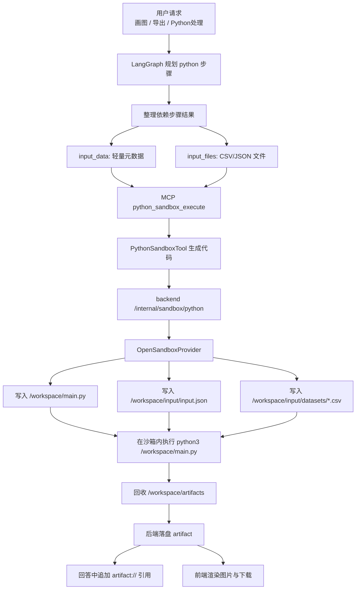

# Python 沙箱与工具构造

本文档说明当前仓库中 Python 沙箱链路的设计原理、数据契约、执行流程与命名规则。本文只描述当前实现，不包含历史方案。

## 设计目标

当前 Python 沙箱链路解决的是一类特定问题：当用户请求需要绘图、导出文件或必须通过 Python 做进一步处理时，Agent 需要把上游结构化结果安全地交给一个隔离执行环境，再把产物回收到产品线程中。

设计目标有四个：

1. 回答上下文保持轻量  
   回答模型不直接消费整张结果表，只看摘要、统计口径和少量预览行。

2. 绘图与文件生成使用真实数据  
   Python 代码必须读取上游真实查询结果，不能从自然语言描述中猜数据，更不能伪造演示数据。

3. 沙箱执行与产品会话解耦  
   Agent 只负责规划和调用工具；真正的沙箱执行、产物落盘、线程绑定由产品后端统一处理。

4. 产物对用户可见且命名正确  
   沙箱内部使用稳定物理路径，用户侧看到的是语义化标题、下载文件名和对话内图片引用。

## 组件分层

当前链路涉及四个层次：

### 1. LangGraph 编排层
- 文件：`services/agent/runtime/langgraph_orchestrator.py`
- 职责：
  - 判断当前步骤是否需要 Python
  - 从依赖步骤结果中抽取轻量上下文与真实表格
  - 构造 `input_data` 与 `input_files`
  - 通过 MCP 调用 `python_sandbox_execute`
  - 把产物信息转成证据和最终回答中的图片引用

### 2. Python 工具层
- 文件：`services/agent/tools/python_sandbox_tool.py`
- 职责：
  - 根据 task/context 生成 Python 代码
  - 对生成代码做约束校验
  - 调用产品后端 `/internal/sandbox/python`

### 3. MCP 工具层
- 文件：`services/agent/services/mcp/server.py`
- 职责：
  - 暴露 `python_sandbox_execute`
  - 把 LangGraph 的调用转换成 Python 工具对象调用

### 4. 产品后端与 OpenSandbox 层
- 文件：
  - `services/backend/main.py`
  - `services/backend/sandbox/opensandbox_provider.py`
  - `services/backend/store.py`
- 职责：
  - 创建沙箱运行记录
  - 把代码、输入元数据和真实文件写入沙箱文件系统
  - 执行 Python
  - 回收 `/workspace/artifacts`
  - 落盘 artifact
  - 绑定线程、运行、标题和下载文件名

## 总体流程

## 为什么不把整表直接塞进模型上下文

当前实现明确把“回答上下文”和“绘图数据”分开处理。

原因是整表直接进入模型上下文会同时带来三个问题：

1. token 浪费  
   大表会显著抬高回答阶段上下文体积，影响成本和稳定性。

2. 语义漂移  
   模型容易把结构化数值重新解释错，例如把前缀宣告总量误说成 AS 个数。

3. 绘图不稳定  
   如果 Python 代码从自然语言描述里反推数据，很容易出现“读取为空”或字段错配。

因此当前实现采用“两路分发”：

- 回答模型只拿到摘要
- Python 沙箱拿到真实 CSV

这也是当前仓库里最核心的设计原则。

## LangGraph 如何构造 Python 输入

入口在 `LangGraphOrchestrator._run_python_step(...)`。

这一层会做两件事：

1. 构造自然语言 `context`
2. 构造结构化 `input_data + input_files`

其中真正关键的是 `input_data + input_files`。

### `input_data`

`input_data` 是一个轻量 manifest，写入沙箱内 `/workspace/input/input.json`。它包含：

- `task`：当前 Python 任务目标
- `context_text`：调用方传入的补充上下文
- `dependencies`：依赖步骤的摘要信息
- `datasets`：可供 Python 读取的数据集清单

`datasets` 中每个条目包含：

- `dataset_id`
- `source_step_id`
- `source_tool`
- `source_objective`
- `format`
- `file_path`
- `columns`
- `row_count`
- `preview_rows`
- `chart_candidate`

这里的 `preview_rows` 只是为了帮助代码生成理解数据形状，不是给 Python 真正消费的全量数据。

### `input_files`

`input_files` 是真实文件列表，当前表格型结果统一写成 CSV。每个条目包含：

- `path`
- `content`

例如：

- `/workspace/input/datasets/1_chart_data_result_1.csv`

### 为什么选 CSV

当前实现优先使用 CSV，而不是把整张表嵌进 JSON 上下文，原因是：

1. 对二维表最自然  
   上游 SQL 结果本身就是 `columns + rows` 结构，序列化成 CSV 最直接。

2. 便于 Python 直接读取  
   标准库 `csv` 或 `pandas.read_csv` 都能直接消费。

3. 体积更稳定  
   对大多数表格结果，CSV 比 JSON 更适合作为跨边界文件载荷。

4. 与“轻元数据 + 真文件”模式天然匹配  
   manifest 负责描述，CSV 负责承载真实数据。

## Python 工具如何生成代码

入口在 `services/agent/tools/python_sandbox_tool.py`。

### 系统约束

`PYTHON_CODEGEN_PROMPT` 对生成代码施加了硬约束：

- 只能输出 Python 代码
- 所有产物必须写入 `/workspace/artifacts`
- 若依赖数据为空必须直接报错
- 禁止使用 sample/mock/fake/demo 数据
- 若需要读取上游结构化结果，优先从 `/workspace/input/input.json` 和对应 CSV 中读取

这部分约束的目的，是把 Python 工具从“会写点演示脚本的模型能力”收敛为“只能围绕真实输入执行的文件生成器”。

### 无三方依赖时的绘图策略

如果任务是图表且没有声明第三方包，工具不会退回到假数据，也不会静默失败，而是走标准库 SVG 方案：

- 读取 `/workspace/input/input.json`
- 找到 `chart_candidate=true` 的数据集
- 根据 `file_path` 打开真实 CSV
- 用标准库生成 SVG
- 写入 `/workspace/artifacts/chart.svg`

这里固定写成 `chart.svg` 是一个刻意设计：

- 沙箱内部只使用稳定 ASCII 物理文件名
- 避免因为中文或特殊字符路径导致底层 SDK 读回 artifact 失败

### 标题生成规则

图表标题不是简单复用 task 文本，而是优先从 `dataset.source_objective` 推断，并做通用清洗：

- 去掉“读取上一步结果”“生成柱状图”“保存为 PNG 文件”等流程性描述
- 统一 `AS`、`IPv4`、`IPv6` 的大小写
- 最终得到面向用户的标题文本

因此沙箱内图表标题可以是：

- `统计中国的 AS 的 IPv4 宣告数量`

而不会是：

- `读取上一步的统计结果，绘制柱状图展示不同 AS 的 IPv4 宣告数量`

## OpenSandbox 执行原理

真正与 OpenSandbox SDK 交互的是 `services/backend/sandbox/opensandbox_provider.py`。

执行流程如下：

1. 创建 `SandboxSync`
2. 预先创建目录
   - `/workspace/artifacts`
   - `/workspace/input`
   - 以及所有输入文件的父目录
3. 一次性写入文件
   - `/workspace/main.py`
   - `/workspace/input/input.json`
   - `/workspace/input/datasets/*.csv`
4. 如有声明第三方包，先执行 `pip install`
5. 运行 `python3 /workspace/main.py`
6. 搜索 `/workspace/artifacts/*`
7. 逐个读取产物字节并返回给后端
8. 关闭并销毁 sandbox

这里有两个当前实现的重要点：

### 1. 不再依赖 Code Interpreter 的 artifact 抽象

当前实现直接运行 `/workspace/main.py`，再从 `/workspace/artifacts` 搜索和读取文件。这么做是为了让“执行是否成功”和“产物是否真实存在”都由文件系统事实决定，而不是依赖更高层的解释器包装结果。

### 2. 文件系统 API 是唯一数据跨边界方式

Agent 与沙箱之间并不存在共享宿主磁盘。当前方案完全依赖 OpenSandbox SDK 的文件写入/读取能力：

- 写入：`sandbox.files.write_files(...)`
- 读取：`sandbox.files.read_bytes(...)`
- 搜索：`sandbox.files.search(...)`

这就是当前仓库的标准数据交互方式。

## 后端如何处理产物

入口在 `services/backend/main.py`。

### 运行记录

后端先创建 `sandbox_run` 记录，记录：

- 线程
- 消息
- 用户
- task
- 代码
- trace_id / run_id

### 产物落盘

每个回收回来的 artifact 会被写入本地存储：

- 目录：`services/backend/store/artifacts/{thread_id}/{sandbox_run_id}/`
- 文件名：随机 UUID + 原扩展名

这里的磁盘文件名不是用户最终看到的名字。它只承担存储职责。

### 用户可见标题与下载文件名

后端通过 `_build_semantic_artifact_title(...)` 重新生成语义化标题，例如：

- `统计中国的 AS 的 IPv4 宣告数量.svg`

这个标题会同时用于：

- 线程 artifact 列表显示
- 下载接口返回的 `filename`

因此现在有三层命名：

1. 沙箱内物理文件名：`chart.svg`
2. 后端磁盘文件名：随机 UUID + `.svg`
3. 用户可见标题/下载文件名：`统计中国的 AS 的 IPv4 宣告数量.svg`

这三层职责不同，不能混用。

## 回答为什么能直接显示图

当前回答并不暴露沙箱路径，也不暴露后端磁盘路径，而是使用：

- `artifact://{artifact_id}`

流程如下：

1. Python 步骤成功后，LangGraph 从步骤结果中收集图片 artifact
2. 回答收尾阶段把缺失的图片引用追加到最终消息
3. 前端 Markdown 渲染器识别 `artifact://...`
4. 前端通过同源代理 `/api/artifacts/{artifact_id}/content` 取图
5. 在回答正文中直接渲染图片

这意味着回答、右侧预览、点击放大、下载文件名，都是围绕同一个 artifact 元数据工作。

## 当前命名规则

当前实现的命名规则是：

### 图表标题
- 来源：优先 `datasets[*].source_objective`
- 清洗：移除流程性动词和输出要求
- 规范化：统一 `AS`、`IPv4`、`IPv6` 大小写

### 沙箱物理文件名
- 固定稳定路径
- 当前标准库绘图默认是 `/workspace/artifacts/chart.svg`

### 用户可见文件名
- 在后端根据语义化标题生成
- 保留正确扩展名
- 作为 artifact `title`
- 作为下载接口 `filename`

## 当前不允许的行为

以下行为在当前实现中被视为错误：

- Python 工具用假数据补图
- Python 从自然语言结论里猜字段和值
- 图表生成失败却在回答里声称“已生成图表”
- 把 `/workspace/...` 路径直接返回给用户
- 把沙箱物理文件名直接当下载文件名

## 排障定位

如果 Python 沙箱链路异常，建议按下面顺序检查：

1. `services/agent/runtime/langgraph_orchestrator.py`
   - 是否正确构造了 `input_data`
   - 是否正确生成了 `input_files`

2. `services/agent/tools/python_sandbox_tool.py`
   - 是否走到了标准库 SVG 分支
   - 是否误判为数据为空

3. `services/backend/sandbox/opensandbox_provider.py`
   - 是否成功写入 `/workspace/input`
   - 是否成功执行 `python3 /workspace/main.py`
   - 是否能从 `/workspace/artifacts` 读回文件

4. `services/backend/main.py`
   - 是否成功创建 artifact
   - 是否标题被语义化改写
   - 是否下载接口返回正确 `filename`

5. `services/webapp/`
   - Markdown 是否包含 `artifact://...`
   - 前端同源代理 `/api/artifacts/{id}/content` 是否返回 200

## 代码入口索引

- LangGraph 编排：`services/agent/runtime/langgraph_orchestrator.py`
- Python 工具：`services/agent/tools/python_sandbox_tool.py`
- MCP 暴露：`services/agent/services/mcp/server.py`
- 后端入口：`services/backend/main.py`
- OpenSandbox 适配器：`services/backend/sandbox/opensandbox_provider.py`
- 前端图片代理：`services/webapp/app/api/artifacts/[artifactId]/content/route.ts`
- 前端 Markdown 渲染：`services/webapp/app/components/markdown-content.tsx`

## 继续阅读

- `overall-architecture.md`
- `query-pipelines.md`
- `../04-operations/deployment.md`
- `../04-operations/agent-chat-ui.md`
